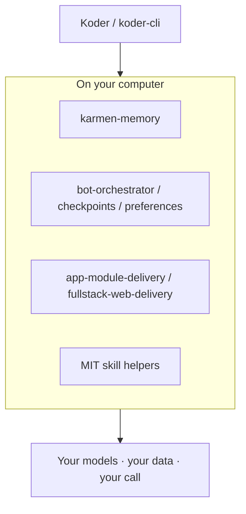

# KARMEN LOOP

English | [简体中文](README.zh-CN.md)

**Local-first tools for coding agents and everyday AI work—memory you approve, task orchestration you can audit, delivery workflows you can run, and MIT skills that stay on your machine.**

KarmenLoop builds [Koder](https://karmenloop.com) and a family of open repositories for people who keep models, data, and decisions on their own computers. Start with the job you need to finish, then open that project’s current release, bilingual guide, and license.

[Website](https://karmenloop.com) · [Email](mailto:info@karmenloop.com) · [Publishing conventions](docs/publishing.en.md)

---

## Why this exists

Coding agents and everyday AI tools forget what you already confirmed, scatter preferences across hosts, and blur demos with production claims. Teams then cannot tell what runs locally, what needs a model account, or what was actually verified.

This profile is the **index** for that stack: local memory and task boards, application and website delivery workflows, small MIT skill helpers that process JSON you supply, and the Koder product line. Each repository states its version, limits, and evidence in English and 简体中文.

---

## How to choose a project

| If you need… | Start here |
| --- | --- |
| Shared local facts across agent tools | [karmen-memory](https://github.com/KarmenLoop/karmen-memory) |
| Dependencies, submissions, evidence, review | [bot-orchestrator](https://github.com/KarmenLoop/bot-orchestrator) |
| Persistent checkpoints and verified handoffs | [personal-agent-growth](https://github.com/KarmenLoop/personal-agent-growth) |
| Sourced preferences with scoped recall | [user-behavior-personalization](https://github.com/KarmenLoop/user-behavior-personalization) |
| App modules with registered acceptance checks | [app-module-delivery](https://github.com/KarmenLoop/app-module-delivery) |
| Website delivery with a runnable example | [fullstack-web-delivery](https://github.com/KarmenLoop/fullstack-web-delivery) |
| One-shot JSON helpers (no model account) | [Small local tools](#small-local-tools) |
| Terminal / product downloads | [Koder](#koder) · [karmenloop.com](https://karmenloop.com) |

---

## Memory and tasks

Local services and boards for **confirmed context**, checkpoints, and review—not chat residue treated as truth.

- [karmen-memory](https://github.com/KarmenLoop/karmen-memory) — Local SQLite memory service with console, CLI, and MCP bridge; candidate review before retrieval; optional trusted-LAN pairing and offline replicas.
- [bot-orchestrator](https://github.com/KarmenLoop/bot-orchestrator) — Local task board for dependencies, submissions, evidence, and review across agent workflows.
- [personal-agent-growth](https://github.com/KarmenLoop/personal-agent-growth) — Persistent task checkpoints and verified handoffs through local CLI and MCP adapters.
- [user-behavior-personalization](https://github.com/KarmenLoop/user-behavior-personalization) — Sourced preferences kept locally, with scoped recall, corrections, and Codex/Cursor adapters.

---

## Application and website delivery

Workflows that plan modules, run acceptance checks, and keep delivery evidence on your machine.

- [app-module-delivery](https://github.com/KarmenLoop/app-module-delivery) — Plan application modules and run registered acceptance checks through local CLI and MCP adapters.
- [fullstack-web-delivery](https://github.com/KarmenLoop/fullstack-web-delivery) — Website-delivery workflow with a runnable fictional business example.

---

## Small local tools

MIT-licensed skills with Python standard-library helpers for **JSON you provide**. No model account is required to run them directly. Each repository has English and Chinese entry pages plus a download-to-practice guide.

| Project | Use it for |
| --- | --- |
| [api-diagnostics](https://github.com/KarmenLoop/skill-api-diagnostics) | Classify recorded API failures and check whether a retry fits the remaining budget. |
| [bug-repro](https://github.com/KarmenLoop/skill-bug-repro) | Build bug reports from reproduction attempts, environment details, and evidence. |
| [calendar-slots](https://github.com/KarmenLoop/skill-calendar-slots) | Find free calendar slots from busy intervals, meeting length, and buffers. |
| [daily-brief](https://github.com/KarmenLoop/skill-daily-brief) | Fit ready tasks into a daily time budget while keeping blocked work visible. |
| [document-diff](https://github.com/KarmenLoop/skill-document-diff) | Compare text revisions, changed numbers, and line endings with a local helper. |
| [file-manifest](https://github.com/KarmenLoop/skill-file-manifest) | Record local file sizes, SHA-256 hashes, and duplicate groups for a handoff. |
| [follow-up-tracker](https://github.com/KarmenLoop/skill-follow-up-tracker) | Sort follow-ups into due, scheduled, and stopped lists from explicit records. |
| [inbox-triage](https://github.com/KarmenLoop/skill-inbox-triage) | Prioritize exported messages by reply status, age, VIP sender, and response target. |
| [meeting-actions](https://github.com/KarmenLoop/skill-meeting-actions) | Verify meeting action items against transcript quotes, owners, and due dates. |
| [memory-ledger](https://github.com/KarmenLoop/skill-memory-ledger) | Resolve scoped facts with provenance, corrections, expiry, and visible conflicts. |
| [patch-risk-review](https://github.com/KarmenLoop/skill-patch-risk-review) | Summarize Git diffs by file, line counts, and areas that need closer review. |
| [project-plan](https://github.com/KarmenLoop/skill-project-plan) | Order dependent tasks and calculate a critical path with explicit acceptance checks. |
| [task-checkpoint](https://github.com/KarmenLoop/skill-task-checkpoint) | Rebuild task state from events and identify what needs verification before resuming. |
| [test-failure-triage](https://github.com/KarmenLoop/skill-test-failure-triage) | Compare JUnit test outcomes across reports and flag mixed pass/fail observations. |

The helpers process supplied records. Sending mail, booking meetings, and connecting accounts require separate tools and authorization.

---

## Koder

For current **Koder** and terminal product information—downloads, terms, and releases—use the [website](https://karmenloop.com). This page only links repository entry points; each product keeps its own installers and license.

[koder-cli](https://github.com/KarmenLoop/koder-cli) · [koder-sdk](https://github.com/KarmenLoop/koder-sdk) · [karmenbot](https://github.com/KarmenLoop/karmenbot)

---

## Stack at a glance

| | |
| --- | --- |
| **Focus** | Local-first AI tooling for coding and everyday work |
| **Languages** | Every listed repo: **English** + **简体中文** README |
| **Skills** | MIT; Python stdlib helpers; no account required to run on supplied JSON |
| **Larger services** | Apache 2.0 or project LICENSE (see each repo) |
| **Evidence** | Releases, guides, and CI named per repository—not this index page |

---

## Is / Is not

| Is | Is not |
| --- | --- |
| Directory of KarmenLoop open repositories and Koder entry points | A hosted SaaS dashboard or cloud memory product |
| Local-first memory, orchestration, delivery, and skill tools | A claim that every skill sends mail or books meetings |
| Bilingual entry pages with stated limits and verification notes | Machine-translated slogans or fabricated usage metrics |
| Pointers to current downloads and docs on each project | A substitute for each repository’s own release notes |

---

## Documentation and support

Open issues in the **relevant** repository with version, actual steps, and result. Each project labels demonstrations, prototypes, and verified behavior separately.

[Documentation and release conventions](docs/publishing.en.md)

Choose **English** or **简体中文** at the top of each repository README. The two entry pages cover the same product version, setup path, and limits. Technical references and historical evidence retain their labeled original language; published installers keep their own language support.

---

## FAQ

### What is KarmenLoop?

An organization and product line building **Koder** and local-first tools for coding agents and everyday AI work—memory, task orchestration, delivery workflows, and MIT skill helpers—under the principle: your computer, your models, your call.

### Where should I start?

Pick the row in [How to choose a project](#how-to-choose-a-project) that matches your job, then follow that repository’s README and latest release. For product downloads, use [karmenloop.com](https://karmenloop.com).

### Do the MIT skills need a model API key?

No. They run on JSON (or related records) you supply with the Python standard library. Model accounts are only needed when you connect a separate host or product that calls a model.

### Is this page the source of truth for versions?

No. Each repository’s tags, `package.json` / metadata, and release assets are authoritative. This profile README is an index; it may lag a fresh tag by a short window.

### Soft discoverability

Phrases that match this org: **local-first AI coding tools**, **Koder CLI**, **local agent memory SQLite**, **MCP task orchestration**, **MIT agent skills JSON helpers**, **bilingual GitHub AI tooling**. Substance lives in the linked repositories—not keyword density.

---

## Contact

Maintainer: [KarmenLoop](https://github.com/KarmenLoop) · Site: [karmenloop.com](https://karmenloop.com) · Email: [info@karmenloop.com](mailto:info@karmenloop.com)

Copyright 2026 KarmenLoop.
