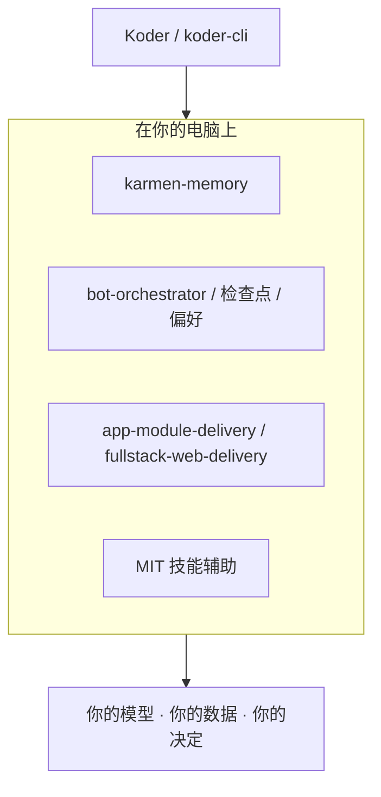

# KARMEN LOOP

[English](README.md) | 简体中文

**面向编码智能体与日常 AI 工作的本地优先工具集：可审阅的记忆、可审计的任务编排、可运行的交付流程，以及留在本机的 MIT 技能。**

卡门循环（KarmenLoop）构建 [Koder](https://karmenloop.com) 与一系列开源仓库，面向把模型、数据与决定留在自己电脑上的人。先按要完成的事选项目，再打开对应仓库的当前发行版、中英教程与许可证。

[官网](https://karmenloop.com) · [邮箱](mailto:info@karmenloop.com) · [发布约定](docs/publishing.zh-CN.md)

<picture>
  <source media="(prefers-color-scheme: dark)" srcset="https://karmenloop-profile.netlify.app/github.gif?lang=zh-CN&amp;theme=dark&amp;motion=animated">
  
</picture>

[自动更新统计](https://karmenloop-profile.netlify.app/?lang=zh-CN) · [静态查看](https://karmenloop-profile.netlify.app/preview.gif?lang=zh-CN&theme=light&motion=static) · [计数说明](counter/README.zh-CN.md)

---

## 为什么做这些

编码智能体与日常 AI 工具容易忘掉已确认的约定，把偏好散落在不同宿主里，并把演示和已验证行为混在一起。团队难以判断什么在本地运行、什么需要模型账号、什么真正测过。

本页是该产品线的**索引**：本地记忆与任务板、应用与网站交付流程、处理你提供的 JSON 的小型 MIT 技能，以及 Koder 产品线。每个仓库用 English 与简体中文写明版本、限制与证据。

---

## 怎么选项目

| 如果你需要… | 从这里开始 |
| --- | --- |
| 在多个智能体工具间共享本地事实 | [karmen-memory](https://github.com/KarmenLoop/karmen-memory) |
| 依赖、交件、证据与审阅 | [bot-orchestrator](https://github.com/KarmenLoop/bot-orchestrator) |
| 持久检查点与可验证交接 | [personal-agent-growth](https://github.com/KarmenLoop/personal-agent-growth) |
| 带来源的偏好与限定检索 | [user-behavior-personalization](https://github.com/KarmenLoop/user-behavior-personalization) |
| 带注册验收检查的应用模块 | [app-module-delivery](https://github.com/KarmenLoop/app-module-delivery) |
| 带可运行示例的网站交付 | [fullstack-web-delivery](https://github.com/KarmenLoop/fullstack-web-delivery) |
| 一次性 JSON 辅助（无需模型账号） | [小型本地工具](#小型本地工具) |
| 终端 / 产品下载 | [Koder](#koder) · [karmenloop.com](https://karmenloop.com) |

---

## 记忆与任务

面向**已确认上下文**、检查点与审阅的本地服务与看板——不把聊天残留当成事实。

- [karmen-memory](https://github.com/KarmenLoop/karmen-memory) — 本地 SQLite 记忆服务，含控制台、CLI 与 MCP 桥；检索前候选人审阅；可选可信局域网配对与离线副本。
- [bot-orchestrator](https://github.com/KarmenLoop/bot-orchestrator) — 本地任务板，记录依赖、交件、证据与审阅。
- [personal-agent-growth](https://github.com/KarmenLoop/personal-agent-growth) — 持久保存任务检查点，通过本地 CLI / MCP 适配器验证交接。
- [user-behavior-personalization](https://github.com/KarmenLoop/user-behavior-personalization) — 本地保存带来源的偏好，支持限定检索、更正及 Codex / Cursor 适配器。

---

## 应用与网站交付

规划模块、跑验收检查，并把交付证据留在本机的工作流。

- [app-module-delivery](https://github.com/KarmenLoop/app-module-delivery) — 制定应用模块计划，并通过本地 CLI / MCP 适配器运行已注册验收检查。
- [fullstack-web-delivery](https://github.com/KarmenLoop/fullstack-web-delivery) — 网站交付流程，附可运行的虚构企业示例。

---

## 小型本地工具

MIT 许可技能，附带 Python 标准库辅助函数，直接处理**你提供的 JSON**，无需模型账号。每个仓库都有中英文入口，以及从下载到实际练习的教程。

| 项目 | 用途 |
| --- | --- |
| [api-diagnostics](https://github.com/KarmenLoop/skill-api-diagnostics) | 对记录的 API 故障分类，并检查重试是否仍在剩余预算内。 |
| [bug-repro](https://github.com/KarmenLoop/skill-bug-repro) | 根据复现尝试、环境信息与证据整理缺陷报告。 |
| [calendar-slots](https://github.com/KarmenLoop/skill-calendar-slots) | 按忙碌区间、会议时长与缓冲找出空闲时段。 |
| [daily-brief](https://github.com/KarmenLoop/skill-daily-brief) | 把可执行任务排进每日时间预算，并保留被阻塞工作可见。 |
| [document-diff](https://github.com/KarmenLoop/skill-document-diff) | 用本地辅助对比文本修订、变更数字与换行差异。 |
| [file-manifest](https://github.com/KarmenLoop/skill-file-manifest) | 记录本机文件大小、SHA-256 与重复组，便于交接。 |
| [follow-up-tracker](https://github.com/KarmenLoop/skill-follow-up-tracker) | 按显式记录把跟进项分为到期、已排期与已停止。 |
| [inbox-triage](https://github.com/KarmenLoop/skill-inbox-triage) | 按回复状态、年龄、VIP 发件人与响应目标给导出邮件排序。 |
| [meeting-actions](https://github.com/KarmenLoop/skill-meeting-actions) | 对照会议逐字稿引用、负责人与截止日期核对行动项。 |
| [memory-ledger](https://github.com/KarmenLoop/skill-memory-ledger) | 在限定范围内解析事实，含出处、更正、过期与可见冲突。 |
| [patch-risk-review](https://github.com/KarmenLoop/skill-patch-risk-review) | 按文件与行数汇总 Git 差异，标出需重点审阅的区域。 |
| [project-plan](https://github.com/KarmenLoop/skill-project-plan) | 理顺依赖任务并计算关键路径，附带明确验收检查。 |
| [task-checkpoint](https://github.com/KarmenLoop/skill-task-checkpoint) | 从事件重建任务状态，标出恢复前需验证的项。 |
| [test-failure-triage](https://github.com/KarmenLoop/skill-test-failure-triage) | 跨报告对比 JUnit 结果，标出通/败混杂观察。 |

工具只处理你提供的记录；发邮件、预订会议或连接账号需要单独工具与授权。

---

## Koder

Koder 与终端产品的当前信息——下载、条款与发行——请查看[官网](https://karmenloop.com)。本页只提供仓库入口；各产品保留自己的安装包与许可。

[koder-cli](https://github.com/KarmenLoop/koder-cli) · [koder-sdk](https://github.com/KarmenLoop/koder-sdk) · [karmenbot](https://github.com/KarmenLoop/karmenbot)

---

## 栈一览

| | |
| --- | --- |
| **重心** | 面向编码与日常工作的本地优先 AI 工具 |
| **语言** | 所列仓库均为 **English** + **简体中文** README |
| **技能** | MIT；Python 标准库辅助；处理所供 JSON 时无需账号 |
| **较大服务** | Apache 2.0 或各仓 LICENSE |
| **证据** | 以各仓库发行版、教程与 CI 为准——不是本索引页 |

---

## 是 / 不是

| 是 | 不是 |
| --- | --- |
| KarmenLoop 开源仓库与 Koder 入口目录 | 托管 SaaS 控制台或云端记忆产品 |
| 本地优先的记忆、编排、交付与技能工具 | 宣称每个技能会替你发信或订会议 |
| 写明限制与验证说明的双语入口 | 机翻口号或虚构使用数据 |
| 指向各项目当前下载与文档 | 替代各仓库自己的发行说明 |

---

## 文档与支持

问题请在**对应**仓库开 issue，并附版本、实际步骤与结果。各项目会分别标明演示、原型与已验证行为。

[文档与发布约定](docs/publishing.zh-CN.md)

在各仓库 README 顶部选择 **English** 或 **简体中文**。两个入口对应同一产品版本、使用路径与限制；技术参考与历史证据按标注保留原始语言。已发布安装包的界面语言以各产品说明为准。

---

## 常见问题

### 卡门循环 / KarmenLoop 是什么？

构建 **Koder** 与本地优先工具的产品线与组织账号，面向编码智能体与日常 AI 工作——记忆、任务编排、交付流程与 MIT 技能——原则是：你的电脑，你的模型，你的决定。

### 我该从哪里开始？

在[怎么选项目](#怎么选项目)里选与你任务匹配的一行，再跟该仓库 README 与最新发行版。产品下载请用 [karmenloop.com](https://karmenloop.com)。

### MIT 技能需要模型 API 密钥吗？

不需要。它们用 Python 标准库处理你提供的 JSON（或相关记录）。只有在你另接会调用模型的宿主或产品时，才需要模型账号。

### 本页是版本的权威来源吗？

不是。各仓库的 tag、`package.json` / 元数据与发行资源才是权威。本页是索引，相对新 tag 可能短暂滞后。

### 软可发现性

与本组织相关的检索表述：**本地优先 AI 编码工具**、**Koder CLI**、**本地智能体记忆 SQLite**、**MCP 任务编排**、**MIT 智能体技能 JSON 辅助**、**双语 GitHub AI 工具**。实质内容在各链接仓库中，不靠堆砌关键词。

---

## 联系

维护者：[KarmenLoop](https://github.com/KarmenLoop) · 官网：[karmenloop.com](https://karmenloop.com) · 邮箱：[info@karmenloop.com](mailto:info@karmenloop.com)

Copyright 2026 KarmenLoop.
